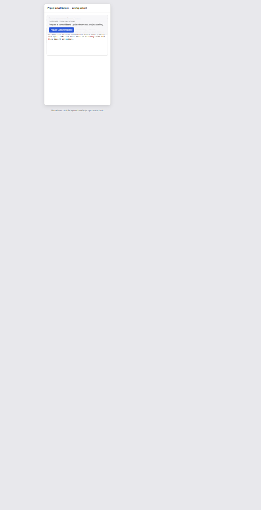
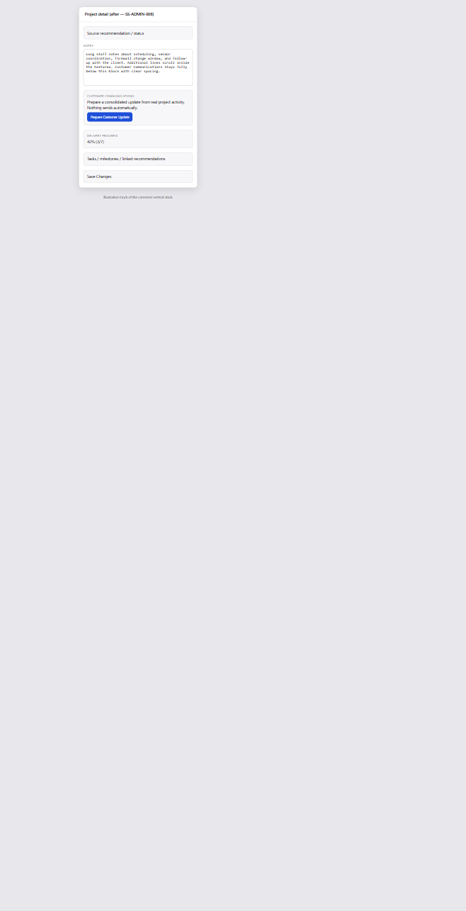

# SS-ADMIN-008 — Project Detail Modal Layout Fix

| Field | Value |
| --- | --- |
| Date | 2026-10-31 |
| Branch | `main` |
| Scope | Admin project detail sheet (Notes / Customer Communications / Delivery Progress) |
| Database | **None** |
| Status | Production deploy authorized |

---

## Root cause

The project detail sheet body wrapped content in a flex column with `min-h-full flex-1`, and the Notes block used `flex min-h-0`. That combination allowed the Notes wrapper to compress below the textarea’s intrinsic height. The textarea then overflowed and painted over the next sibling (Customer Communications / Prepare Customer Update), which looked like absolute stacking even though no absolute positioning was used on those sections.

Customer Communications was also nested inside the Delivery Progress bordered panel, which made the overlap harder to isolate.

---

## Fix

1. Use normal document flow in the sheet body (`flex flex-col gap-5`) — no `min-h-full` / `min-h-0` compression around Notes.
2. Give the Notes textarea `min-h-[8rem]`, `max-h-60`, and `overflow-y-auto` so long notes scroll inside the field.
3. Lift `ProjectCustomerUpdatePanel` to sit **between** Notes and `ProjectDeliveryPanel` in `projects-dashboard.tsx`.
4. Keep Delivery Progress / Tasks / Milestones / Linked Recommendations inside `ProjectDeliveryPanel`.
5. Stack the Customer Communications header and Prepare Customer Update button vertically on narrow widths (`flex-col` → `sm:flex-row`).

No persistence, status, scoring, or send behavior changes.

---

## Files modified

| Path | Change |
| --- | --- |
| `src/components/projects/projects-dashboard.tsx` | Sheet section order + Notes layout |
| `src/components/projects/project-delivery-panel.tsx` | Remove nested customer-update panel |
| `src/components/projects/project-customer-update-panel.tsx` | Responsive header/button spacing |
| `tests/ux/ss-admin-008-project-modal-layout.test.ts` | Layout regression tests |
| `tests/ux/ss-ux-013-project-tasks-milestones.test.ts` | Expect customer panel on dashboard |
| `tests/ux/ss-ux-015-project-communications.test.ts` | Wire assertion updated |
| `docs/releases/ss-admin-008/*` | Before/after illustrative mocks + PNGs |
| `docs/releases/SS-ADMIN-008-PROJECT-MODAL-LAYOUT-FIX.md` | This report |

---

## Before / after

Illustrative layout mocks (not production customer data):

---

## Validation results

| Gate | Result |
| --- | --- |
| `npm test -- tests/ux/ss-admin-008-project-modal-layout.test.ts tests/ux/ss-ux-013-project-tasks-milestones.test.ts tests/ux/ss-ux-015-project-communications.test.ts` | **34/34 pass** |
| `npm run lint` | **0 errors** |
| `npm run build` | **PASS** |
| Migrations | **None** |

---

## Production commit / deployment

| Item | Value |
| --- | --- |
| Pre-fix tip | `89f945b11fea6895f4023d51da7d505a23ec6484` |
| Production commit SHA | `06420e1f10771f1c164a53456ace3943e99b6154` |
| Deployment ID | `dpl_89A3XFofg8AhfBbwNMG9998ycRKj` |
| Deployment status | **Ready** ? `https://stackscore.tech` (Commit `8a8cf64`) |

---

## Remaining issues

- Live authenticated admin screenshot on production requires staff SSO; illustrative mocks document the layout correction. Operator should open Projects → project sheet after deploy and confirm with a long-notes project.
- Optional follow-up: delete unused HTML mock pages once live screenshots replace them.
