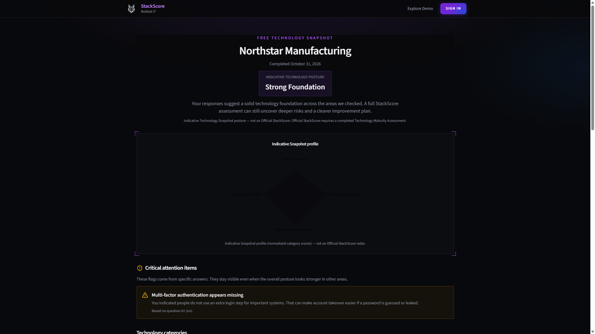
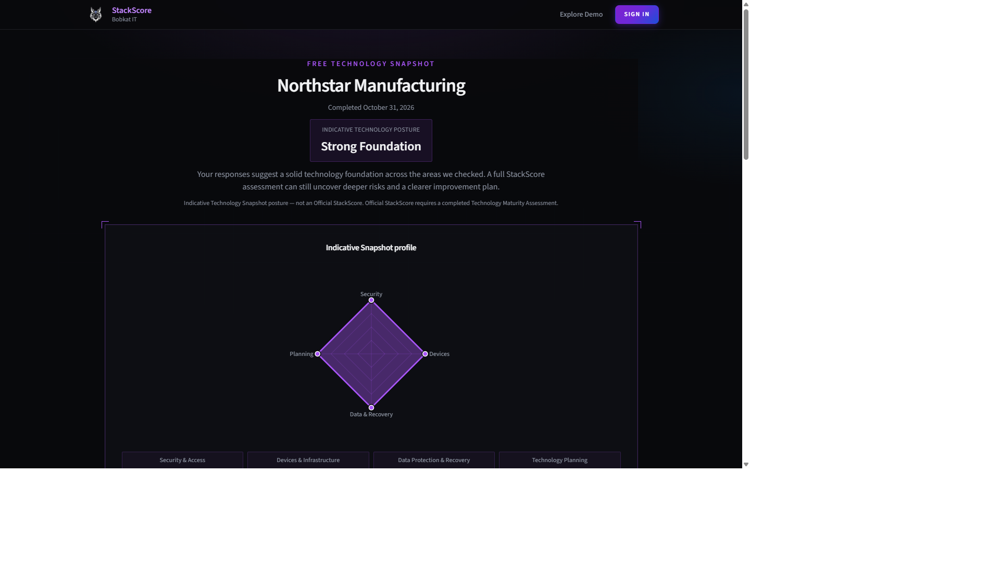
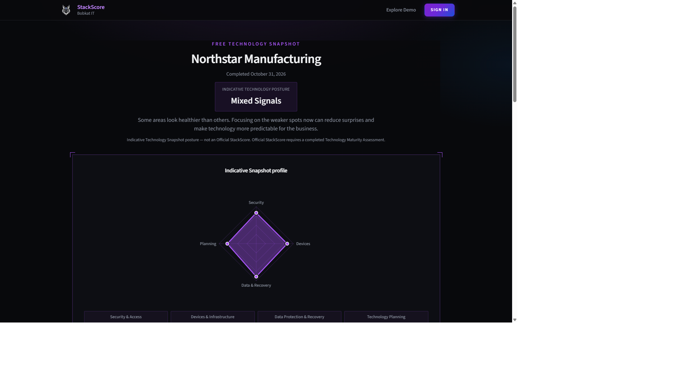
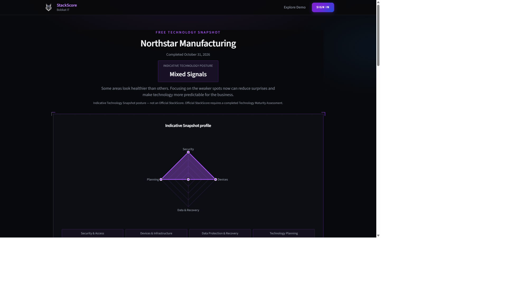
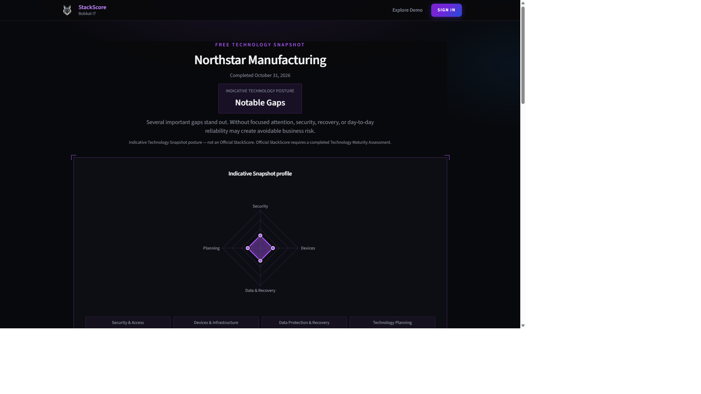
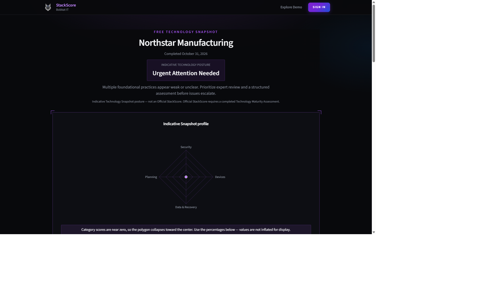

# SS-SNAP-004 — Radar Visibility and Dashboard Visual QA

**Project:** StackScore  
**Priority:** P1 — Prelaunch Visual Correction  
**Environment:** Staging / local preview only  
**Reference:** SS-SNAP-003  
**Production:** Not authorized — stop for visual approval  

**Date:** 2026-10-31  
**Preview:** `http://localhost:3018/technology-snapshot` (`next start` after production build)

---

## Objective

Improve visibility, contrast, and presentation of the four-axis radar on the Free Technology Snapshot results dashboard so the product owner can immediately identify categories, polygon shape, strongest category, and weakest category — without inflating or fabricating scores.

---

## Root cause of low polygon visibility

The Snapshot radar (introduced in SS-SNAP-003) styled stroke/fill with Recharts-style tokens:

```ts
stroke="hsl(var(--primary))"
fill="hsl(var(--primary))"
```

StackScore theme tokens expose `--primary` / `--brand-primary` as **hex** (`#a855f7`), not HSL channels. Wrapping hex in `hsl(...)` produces an **invalid CSS color**, so the polygon stroke and fill failed to paint. The grid remained faintly visible, which made the chart look empty or “barely there” in screenshots.

Secondary contributors:

| Factor | Effect |
| --- | --- |
| Thin / default stroke | Even after a valid color, prominence was weak on charcoal |
| Low / missing fill opacity | Shape hard to read vs grid alone |
| No vertex markers | Hard to spot axis values when the polygon was small |
| Long axis labels (“Security & Access”, etc.) | Clipping risk on mobile; competed with the plot |
| Near-zero scores | Legitimate collapse to center — previously no accessible explanation |

---

## Styling changes

**File:** `src/components/technology-snapshot/snapshot-radar.tsx`

| Property | Before (effective) | After |
| --- | --- | --- |
| Stroke | Invalid `hsl(var(--primary))` → invisible | `var(--brand-primary, #a855f7)` |
| Fill | Same invalid color | Same brand violet |
| Stroke width | Default / thin | `2.75` px |
| Fill opacity | Ineffective | `0.38` |
| Vertex markers | None / default | Custom halo + brand-filled dots (`SnapshotRadarVertex`) |
| Grid | Competing or unclear | Subdued `color-mix(... brand-primary 22%, transparent)` |
| Axis labels | Full category names | Short labels: Security / Devices / Data & Recovery / Planning |
| Outer radius | Larger (clip risk) | `68%` with margins for label room |
| Domain | 0–100 normalized % | Unchanged — no inflation |
| Collapsed profile | Silent | Notice when max category % ≤ 5 |
| Numeric readout | Weak | 2×2 / 4-col percent cards under the chart |

**Dashboard panel** (`snapshot-results-dashboard.tsx`): slightly stronger primary border/padding around the radar panel so the chart reads as a primary dashboard component.

**Tests:** `tests/layout/technology-snapshot-layout.test.ts` asserts brand-violet tokens, `strokeWidth={2.75}`, `fillOpacity={0.38}`, vertex component, and **no** `hsl(var(--primary))`.

**Accuracy constraints honored:**

- Still uses four normalized Snapshot category percents from `buildSnapshotFindingsV2`
- No minimum displayed score, no fabricated values, no scoring or band changes
- Near-zero profiles rely on markers + collapse notice + percent cards

---

## Screenshots — scoring profiles (desktop 1440×900)

Before (SS-SNAP-003 era invisible polygon):



### 1. Strong Foundation (all `yes`)

Large symmetric violet diamond; all axes at the outer ring; labels unclipped.



### 2. Mixed Signals (alternating `yes` / `partially`)

Mid-scale asymmetric polygon; shape and relative strength remain clear.



### 3. Uneven category performance (`yes` except Data Protection `no`)

Three strong axes with Data & Recovery collapsed to center — weakest category obvious without score inflation.



### 4. Notable Gaps (all `unsure`)

Small but still-legible centered polygon with vertex markers.



### 5. Urgent Attention Needed (all `no`)

Polygon collapses to center (accurate 0%). Collapse notice + 0% category cards preserve readability without misrepresenting scores.



---

## Screenshots — responsive

### Strong Foundation — mobile (390×844)

Short labels remain legible; polygon fills the plot; percent cards stack in a 2-column grid; no horizontal overflow observed.


### Urgent Attention — mobile

Center marker + collapse notice visible; chart remains a prominent component on small screens.


---

## Full dashboard review (results experience)

While capturing profiles, the results page hierarchy was reviewed:

| Area | Observation |
| --- | --- |
| Visual hierarchy | Posture band → radar → categories → key findings → CTAs → optional contact |
| Category cards | Accordion with classification, strength/concern, next step — consistent |
| Critical risk alerts | Amber treatment when A1/C1/C2/C3 = `no`; visible on urgent / uneven |
| Three prioritized opportunities | Present under Key findings |
| Consultation CTA | Primary CTA retained |
| Full assessment CTA | `$1,500` offer + demo link retained |
| Optional contact capture | Below results; not required to view radar |
| Radar prominence | Panel border/`bg-card` framing improved; mobile height `h-72` → `md:h-[22rem]` |

No unrelated redesigns were applied outside Snapshot results radar/panel presentation.

---

## Validation

| Check | Result |
| --- | --- |
| `npm test -- tests/layout/technology-snapshot-layout.test.ts` | Pass (5 tests) |
| `npm test -- tests/technology-snapshot/engine-v2.test.ts` | Pass (run with this ticket) |
| `npm run lint` | Pass (exit 0) |
| `npm run build` | Pass (exit 0) |

Scoring engine and classification thresholds were not modified in this ticket.

---

## Acceptance criteria checklist

| Criterion | Status |
| --- | --- |
| Four technology categories identifiable | Met (short axis labels + percent cards + category section) |
| Polygon overall shape immediately visible | Met (brand stroke 2.75 + fill 0.38 + markers) |
| Strongest category readable | Met (shape + cards + key findings) |
| Weakest category readable | Met (uneven/urgent profiles verified) |
| No score inflation / fabrication | Met |
| Desktop + mobile contrast / no clipping | Met for short labels; see remaining issues |

---

## Remaining issues

1. **Near-zero polygons** will always look like a center dot — by design. Rely on the collapse notice and percent cards; do not inflate.
2. **“Data & Recovery”** is the longest short label; on very narrow widths it sits close to the plot edge (acceptable after `outerRadius="68%"`, monitor on ≤360px devices).
3. **Staging deploy / production** — not in scope. Apply SS-SNAP-003/004 to staging after PO visual approval; production remains unauthorized.
4. **SS-SNAP-003 Prisma migration** (`20261031120000_snapshot_v2_findings`) may still need operator apply on staging for lead persistence — independent of radar visuals.

---

## Decision required

**Stop for visual approval.** Do not deploy to production.

Please confirm the radar prominence and multi-profile screenshots above are acceptable before staging promotion.
